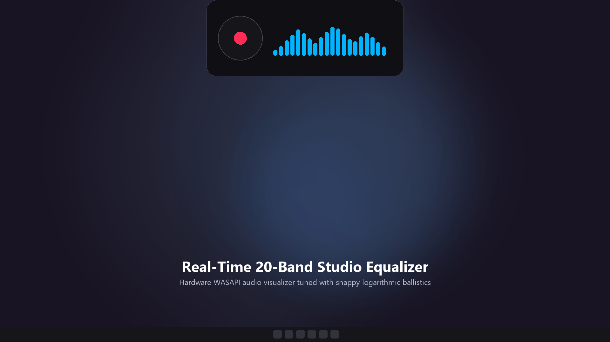
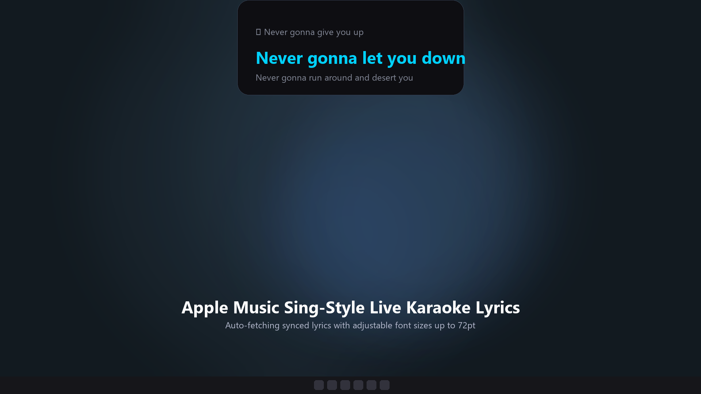
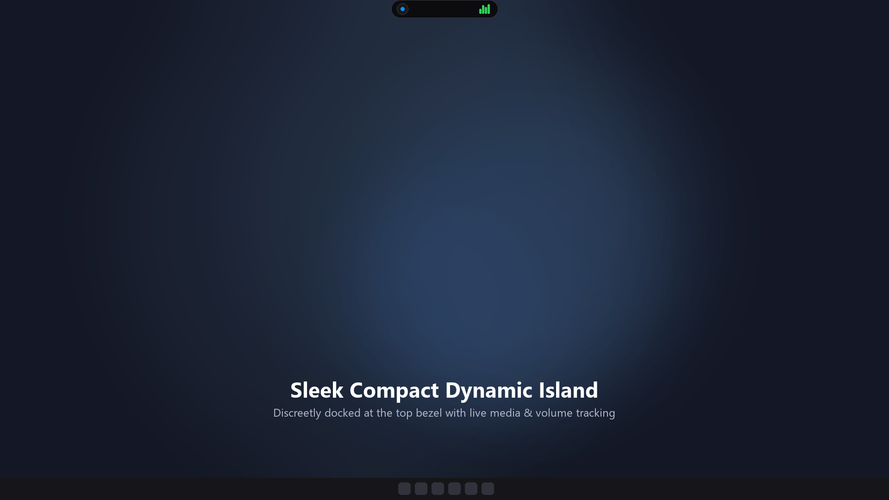
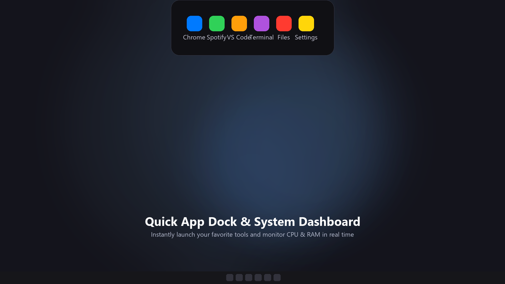

# 🏝️ Dynamic Island for Windows

[](https://microsoft.com/windows)
[](https://dotnet.microsoft.com)
[](LICENSE)
[](#)

A sleek, fluid, and non-intrusive **Dynamic Island** experience for **Windows 10 & 11**, built natively with **C# and WPF**. Features **Stealth Auto-Hide (zero interference with browser tabs)**, **Real-Time Hardware FFT Audio Spectrum**, **Live Synced Lyrics**, **Media Controller**, and **Quick App Dock**.

---

<p align="center">
  
  
</p>
<p align="center">
  
  
</p>

---

## ✨ Key Features

### 1. 🥷 Stealth Peek Notch & Auto-Hide (Tab-Friendly)
* When inactive, Dynamic Island collapses into an ultra-slim `72 x 3 px` accent strip docked against the top screen bezel.
* **100% Non-Intrusive**: Browser tabs (Chrome, Edge, Firefox, Brave) remain fully visible and clickable without being obscured.
* Simply move your cursor to the top edge of the screen to smoothly expand the island.

### 2. 🎵 Real-Time Hardware Audio Spectrum (WASAPI Loopback FFT)
* Captures raw system audio via **Windows Core Audio (WASAPI Loopback)** with a custom **256-sample Cooley-Tukey FFT**.
* Visualizes live frequency bands from your speakers or headphones:
  * **Bass & Sub-bass** (Kick drums & basslines)
  * **Midrange** (Vocals & guitars)
  * **Treble & Highs** (Cymbals & percussion)
* Powered by fluid exponential decay physics for studio-grade equalizer movement.
* Positioned directly beside the live album artwork in the expanded media card.

### 3. 🎤 Live Synced Lyrics
* Automatically syncs and displays scrolling real-time song lyrics.
* Supports active karaoke-style tracking for supported media players.

### 4. 🎧 Automatic Media Source Detection
* Accurately detects and identifies the active media session:
  * **Spotify**
  * **Apple Music**
  * **Google Chrome / Microsoft Edge / Firefox / Brave**
  * **VLC Media Player / Windows Media Player**
  * Any application supporting Windows System Media Transport Controls (SMTC).

### 5. 🎨 Customizable Equalizer & Visual Themes
* **5 Built-in Color Themes**:
  * 🟢 **Neo Green** (Spotify / iOS aesthetic)
  * 🌈 **Rainbow Spectrum** (Full gradient spectrum)
  * 🔵 **Cyber Cyan** (Vibrant neon blue)
  * ⚪ **Minimalist White** (Clean Apple UI)
  * 🟠 **Sunset Amber** (Warm studio glow)
* **Spectrum Sensitivity Modes**: Normal (1.0x), High (1.5x), Ultra Boost (2.0x).

---

## 🎮 Controls & Interactions

| Action | Behavior |
|---|---|
| **Hover Top Bezel** | Expands island from stealth peek notch |
| **Mouse Leave** | Smoothly collapses back to the top bezel (~650ms delay) |
| **Single Click (Capsule)** | Expands to full Media & Spectrum Card |
| **Double Click** | Pins island in place (disables auto-hide) |
| **Gear Icon ⚙️** | Opens Spectrum Theme & Sensitivity settings |
| **Pin Icon 📌** | Locks/unlocks current expanded state |
| **Shift + Drag** | Freely reposition the island anywhere on screen |
| **Right Click** | Context Menu (Pin, Auto-Hide, Media Controls, Refresh, Exit) |

---

## 🚀 Building from Source

### Prerequisites
* Windows 10 (1903+) or Windows 11
* [.NET 8.0 SDK](https://dotnet.microsoft.com/download/dotnet/8.0)
* Visual Studio 2022 (with .NET Desktop Development workload) or VS Code

### Clone & Build
```bash
git clone https://github.com/arcdefense/aiadynamic.git
cd aiadynamic
dotnet build -c Release
```

### Run
```bash
dotnet run -c Release
```

Or execute `run.bat` / run the generated binary in `bin/Release/net8.0-windows/DynamicIsland.exe`.

---

## 📦 Creating the Installer

To build the self-contained single-file installer:
1. Install [Inno Setup 6+](https://jrsoftware.org/isdl.php).
2. Run the PowerShell build script:
   ```powershell
   ./build-release.ps1
   ```
3. Compile `installer.iss` using Inno Setup to produce the standalone setup executable.

---

## 📄 License

This project is licensed under the [Apache License 2.0](LICENSE).
